# Лабораторна робота №4

## Тестування HTTP API за допомогою Postman

**Виконав:** Зиков Олександр

**Дата:** 20.10.2026

---

## Test Object

Postman Echo. Base URL: `https://postman-echo.com`

## Collection

`Lab 4 - API Testing`. Collection Variable: `baseUrl = https://postman-echo.com`

Колекцію створено у веб-інтерфейсі Postman через **+ → Collection**, змінну `baseUrl` додано у вкладці **Variables** колекції. Синтаксис підстановки `{{baseUrl}}` використовується в URL кожного запиту замість повної адреси.

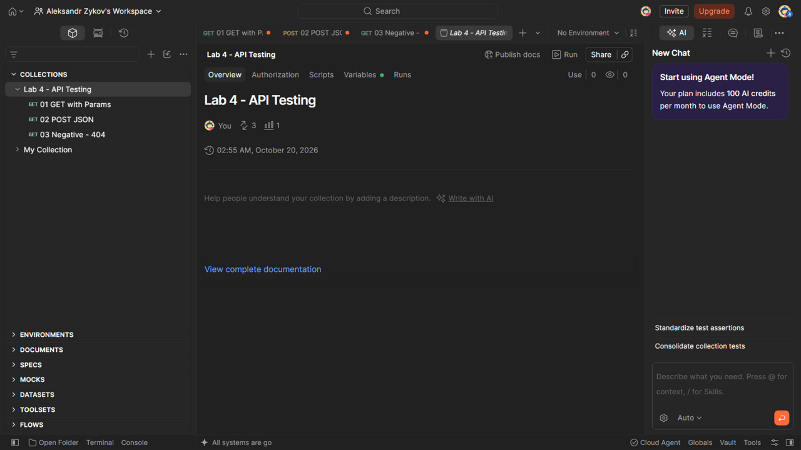

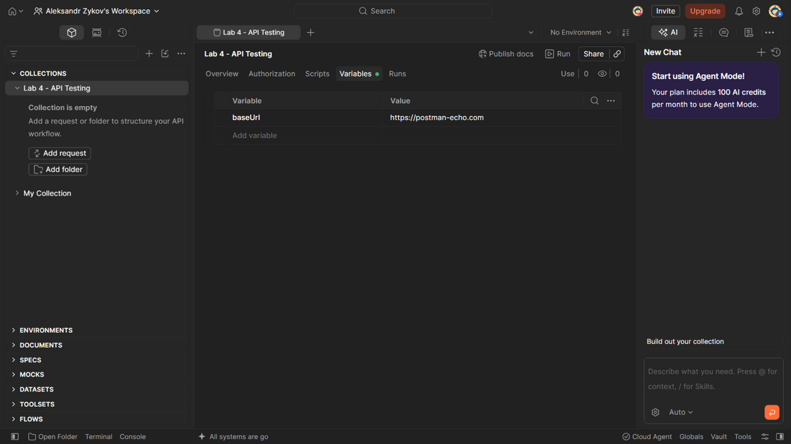

## 1 - GET with Params

**Method:** GET, **URL:** `{{baseUrl}}/get`, Query Parameters: `name = Oleksandr`, `role = student`.

Після виконання Request Response проаналізовано вручну (Status, Body, Headers, Response Time): Status = 200, у Body в об'єкті `args` повернулися передані параметри.

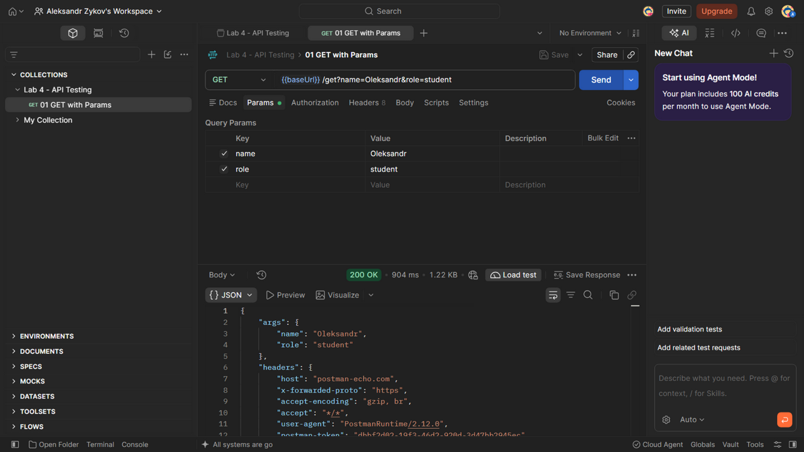

Далі у вкладці **Scripts → After response** додано чотири автоматизовані перевірки: статус 200 (`pm.response.to.have.status(200)`), Content-Type містить application/json (`.to.include()`), значення `json.args.name` та `json.args.role` (`.to.eql()`).

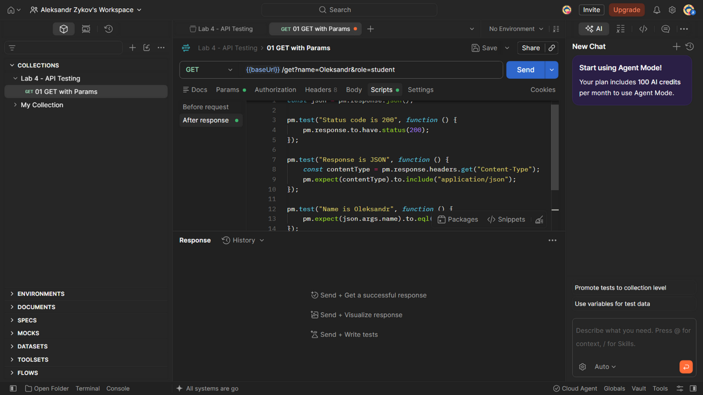

Повторний Send - Test Results **4/4 PASSED**.

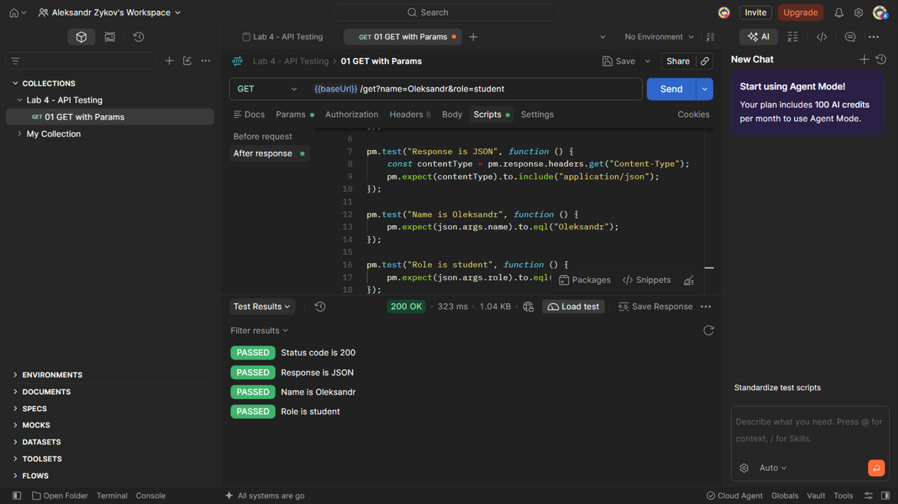

## Експеримент (Actual ≠ Expected)

Тимчасово дані запиту не відповідали очікуванню тесту (роль teacher замість student) - тест `Role is student` отримав **FAILED** з AssertionError, оскільки Actual ≠ Expected. Після відновлення коректних даних усі перевірки знову PASSED.

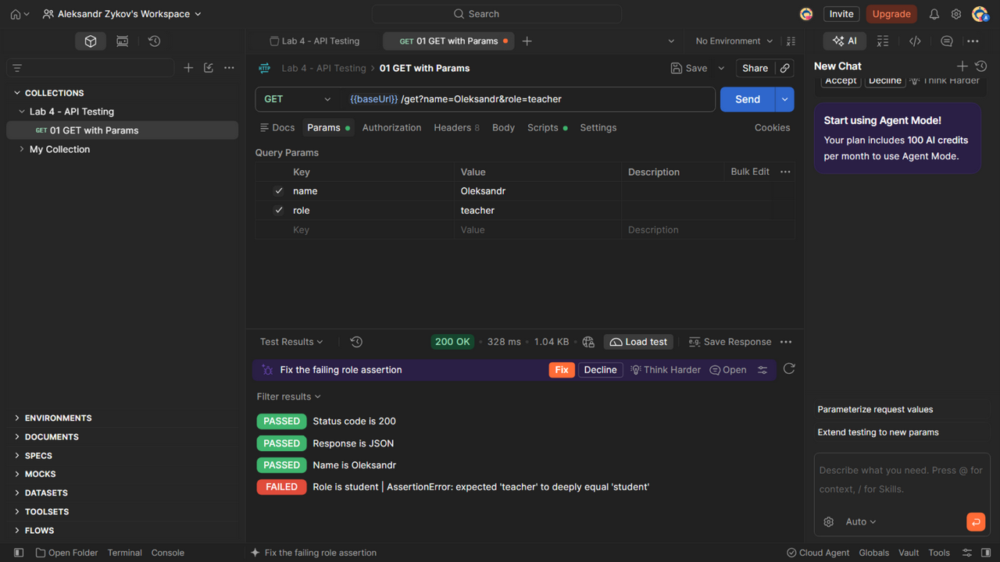

## 2 - POST JSON

**Method:** POST, **URL:** `{{baseUrl}}/post`, Body → raw → JSON:

```json
{
    "product": "Backpack",
    "quantity": 2
}
```

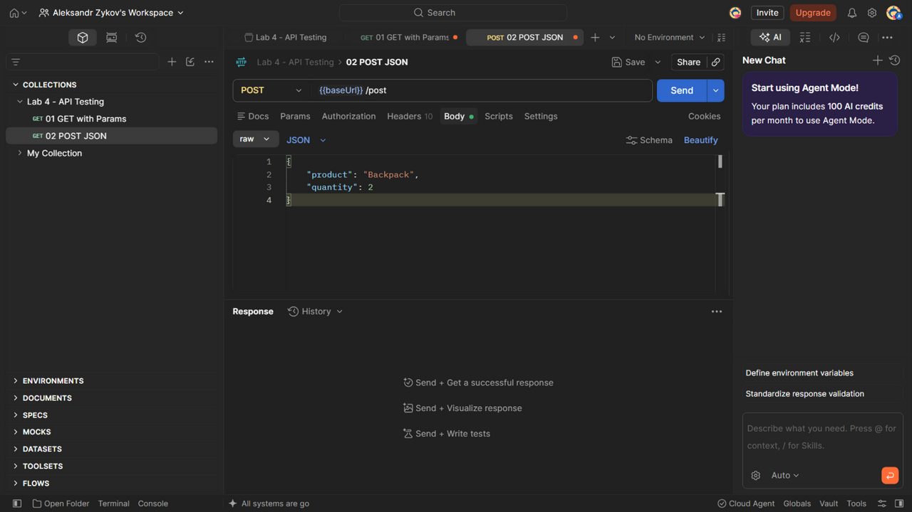

У Scripts → After response додано п'ять перевірок: статус 200, наявність властивості (`pm.expect(json.data).to.have.property("product")` - Echo повертає JSON-дані у полі `data`), значення product (`.to.eql()`), значення quantity (`.to.eql(2)`) та його тип (`.to.be.a("number")`). Send - Test Results **5/5 PASSED**.

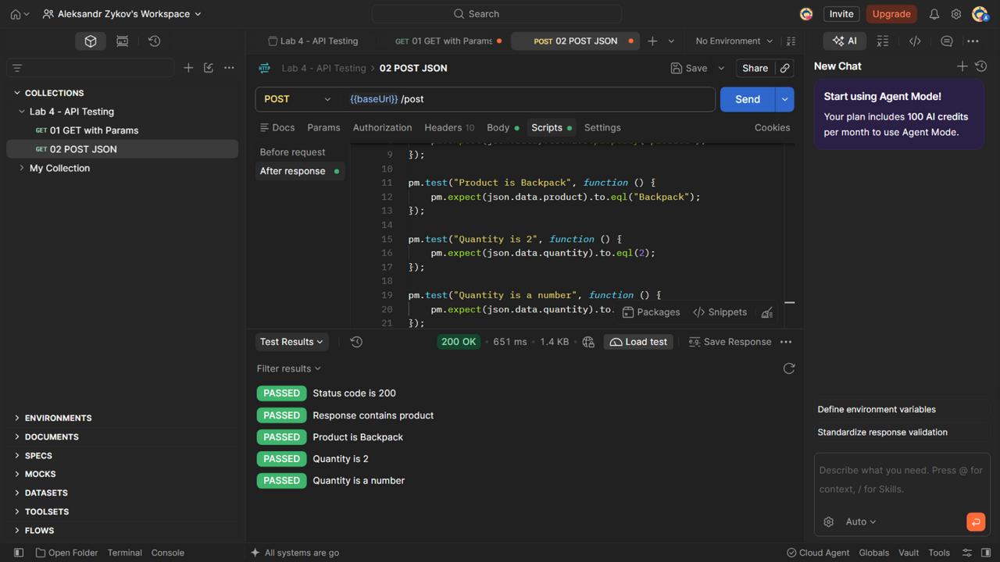

## 3 - Negative Test

**Method:** GET, **URL:** `{{baseUrl}}/status/404`. Самостійно реалізовано два тести: `Status code is 404` (`pm.response.to.have.status(404)`) та `Response status is 404` (`pm.expect(json.status).to.eql(404)`).

Send - HTTP Status = **404 Not Found**, Body містить `status = 404`, Test Results **2/2 PASSED**: HTTP 404 - це очікуваний результат за Test Basis, а не провалений тест.

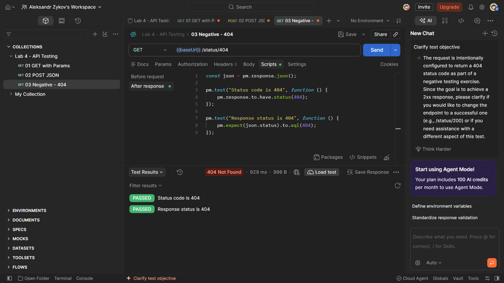

## Загальний результат

| Request | Tests | Passed | Failed |
| :--- | :--- | :--- | :--- |
| GET with Params | 4 | 4 | 0 |
| POST JSON | 5 | 5 | 0 |
| Negative - 404 | 2 | 2 | 0 |
| **Усього** | **11** | **11** | **0** |

Колекцію збережено у форматі Postman Collection v2.1: `lb4/Lab4.postman_collection.json` (3 запити, 11 автоматизованих перевірок). Повний прогін колекції додатково виконано через Newman - офіційний CLI-ранер Postman:

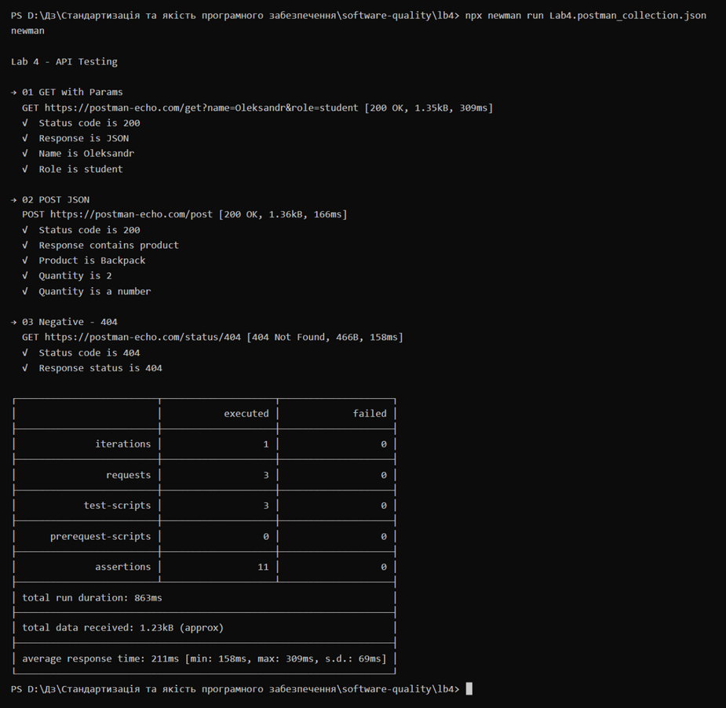

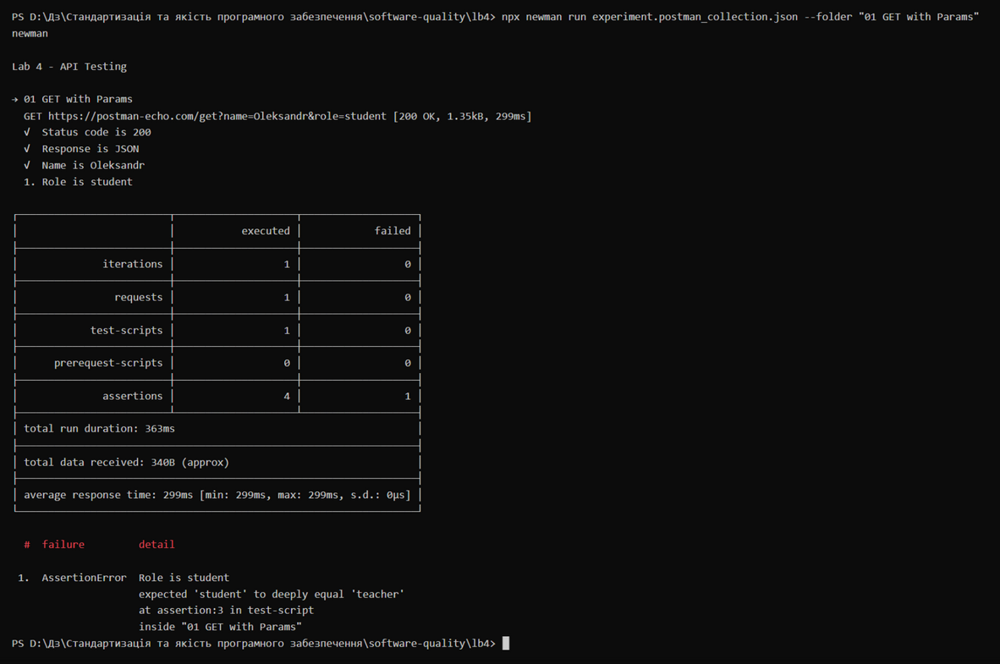

## Висновок

У ході лабораторної роботи відпрацьовано тестування HTTP API за допомогою Postman:

- створено та організовано Collection `Lab 4 - API Testing` з трьома запитами; Collection Variable `baseUrl` дозволяє зберігати адресу сервісу в одному місці та підставляти її синтаксисом `{{baseUrl}}`;
- Response кожного запиту проаналізовано вручну (Status, Body, Headers, Response Time), після чого перевірки автоматизовано у Post-response Tests через `pm.test()`, `pm.response` та `pm.expect()`;
- застосовано різні assertions під задачу: `.to.have.status()` для статусу, `.to.include()` для заголовка з додатковими параметрами, `.to.eql()` для значень, `.to.have.property()` для існування властивості, `.to.be.a()` для типу;
- негативний запит `GET /status/404` повернув очікувані HTTP 404 та `status = 404` у Body, тож обидва його тести PASSED: HTTP 404 - це очікувана поведінка API за Test Basis, а не провалений тест;
- за фактичним запуском усі 11 автоматизованих перевірок мають статус PASSED (0 FAILED);
- експеримент із невідповідністю очікування фактичним даним підтвердив, що тести порівнюють Actual з Expected і чесно повідомляють про розбіжність;
- колекцію з 3 запитами та 11 перевірками збережено у JSON (`lb4/Lab4.postman_collection.json`, формат Collection v2.1).
