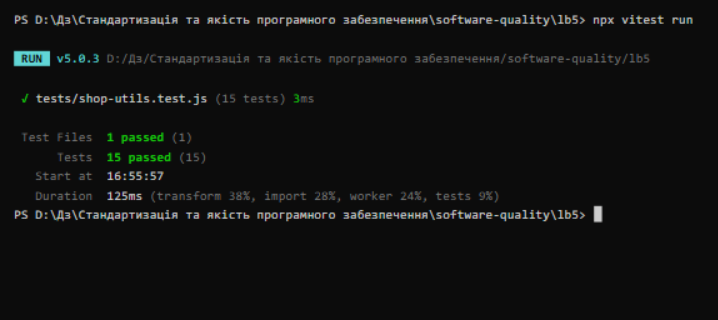
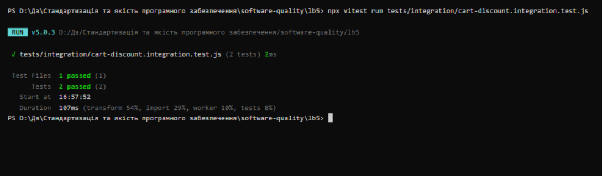
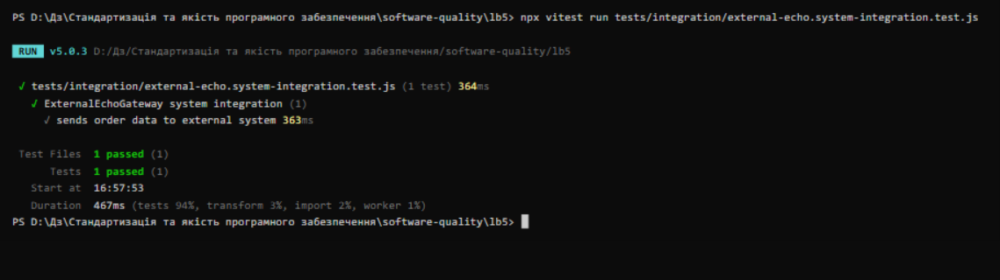
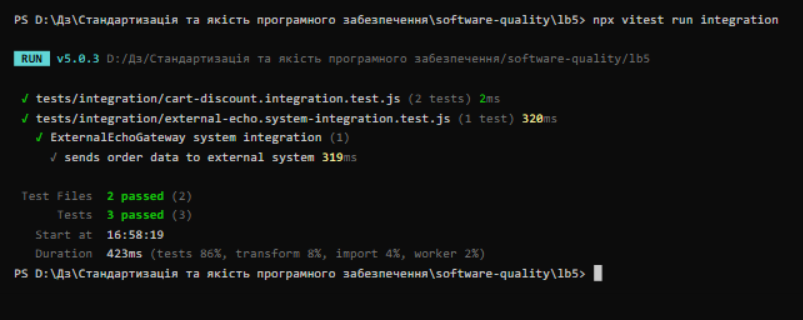
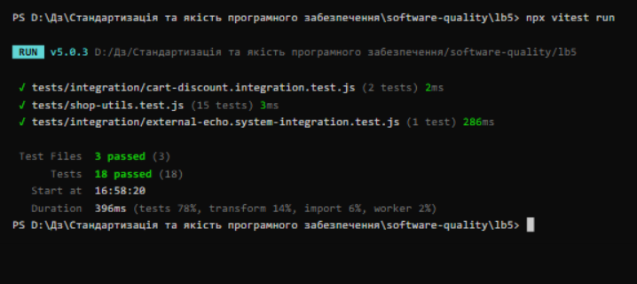
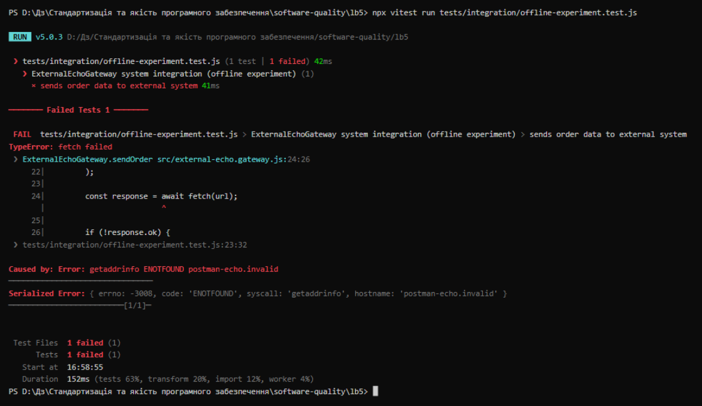

# Лабораторна робота №5

## Інтеграційне тестування компонентів та зовнішніх систем

**Виконав:** Зиков Олександр

**Дата:** 02.11.2026

---

## Test Object та Test Basis

| Test Basis | Опис |
|---|---|
| TB-01. CartService | Дозволяє додавати товари із ціною та кількістю. Загальна сума: total = Σ price × quantity. Метод getFinalTotal(discountPercent) розраховує загальну суму та застосовує до неї calculateDiscount() із shop-utils.js |
| TB-02. Discount | calculateDiscount(price, percent) (з ЛР №3): 100, 10 → 90; 100, 0 → 100; 100, 100 → 0. Для percent поза діапазоном 0-100 виникає помилка: "Discount must be between 0 and 100" |
| TB-03. External Echo Gateway | Компонент ExternalEchoGateway надсилає до зовнішнього сервісу orderId та total через HTTP Request. Зовнішня система - Postman Echo, яка повертає в JSON деталі отриманого request (для GET /get передані параметри повертаються в об'єкті args) |

## Тестове середовище

- Операційна система: Windows 10 (x64, build 19045)
- Node.js: v24.12.0, npm: 11.6.2
- Vitest: v5.0.3
- Дата тестування: 02.11.2026

## Хід роботи

1. Створено гілку `lb5`; у теці `lb5/` розміщено вміст з ЛР №3 (src/shop-utils.js, tests/shop-utils.test.js), залежності встановлено (`npm ci`)
2. Перевірено, що старі тести працюють: `npx vitest run` - 15 passed
3. Додано `src/cart-service.js` та `src/external-echo.gateway.js`
4. Створено інтеграційні тести у `tests/integration/`
5. Виконано запуски, проаналізовано результати
6. Результати зафіксовано у цьому звіті



## 1. Component Integration Testing

### Test Object

`CartService <-> shop-utils`

Test Object тепер не просто одна функція, а зв'язка: перевіряємо, чи правильно два реальні компоненти працюють разом. **Mock не використовувався** - немає vi.fn() і підмінених реалізацій, працюють реальний CartService + реальний calculateDiscount().

### Scenario 1 - Discount

Test Condition 1: CartService правильно використовує calculateDiscount() для загальної суми кошика.

Test Data:

- item 1: price = 100;
- item 2: price = 200;
- discount = 10%.

Загальна сума: 100 + 200 = 300. Знижка 10%.

Expected Result: `270`

Actual Result: `270`

Result: `Pass`



### Scenario 2 - Invalid Discount

Test Condition 2: коректне передавання помилки від calculateDiscount() через CartService до того, хто викликав метод.

Test Data:

- item: price = 100;
- discount = 110%.

Expected Result: `Discount must be between 0 and 100`

Actual Result: `Discount must be between 0 and 100` (помилка коректно передана від calculateDiscount() через CartService)

Result: `Pass`

Чому Negative Test теж PASS? Тому що Expected (Error) співпав з Actual (Error): Negative Test ≠ Failed Test.

## 2. System Integration Testing

### Test Object

`ExternalEchoGateway ↔ Internet ↔ Postman Echo`

Тест Object розширюється: перевіряється реальна межа між нашим кодом і незалежно розгорнутим зовнішнім HTTP-сервісом.

### Test Data

- orderId = `ORD-001`;
- total = `270`.

### Expected Result

Gateway повинен отримати від зовнішньої системи передані дані та повернути:

```json
{
    "orderId": "ORD-001",
    "total": 270
}
```

### Scenario - Sends order data to external system

Gateway формує URL із Query Parameters: `https://postman-echo.com/get?orderId=ORD-001&total=270`. Оскільки Echo повертає query parameters як String, у gateway виконується конвертація `Number(data.args.total)`.

Actual Result: `{ orderId: 'ORD-001', total: 270 }`

Result: `Pass`



## Загальні результати запусків

Всі інтеграційні тести (`npx vitest run integration`):



Весь Test Suite (`npx vitest run`) - нові тести не зламали тести з ЛР №3:



## Порівняння рівнів тестування

| Ознака | Component Test | Component Integration | System Integration |
|---|---|---|---|
| Приклад | calculateDiscount() | CartService ↔ calculateDiscount() | Gateway ↔ Postman Echo |
| Межа | Один компонент | Компоненти нашої системи | Наша система + зовнішня |
| Network | Ні | Ні | Так |
| External service | Ні | Ні | Так |
| Швидкість | Висока | Висока | Залежить від мережі |
| Причин Fail | Менше | Більше | Ще більше |

## Експеримент (Test Environment)

За методичкою перевіряється поведінка тестів, коли мережа недоступна: System Integration Test має падати (FAIL), а Unit та Component Integration - проходити (PASS).

Цей режим відмови відтворено контрольовано: інтернет фізично не вимикався - тест виконувався з конфігурацією gateway, що вказує на недосяжний хост, через що DNS-резолвінг завершується помилкою. Це той самий режим відмови, що й за повного відключення мережі, але відтворений безпечніше (без втрати зв'язку самої робочої машини):

```text
FAIL  tests/integration/offline-experiment.test.js > sends order data to external system
TypeError: fetch failed
Caused by: Error: getaddrinfo ENOTFOUND postman-echo.invalid
Test Files  1 failed (1)
     Tests  1 failed (1)
```



Result: System Integration Test - **FAIL**, Unit та Component Integration тести - **PASS**.

Висновок з експерименту: System Integration Test сильніше залежить від Test Environment (мережі, DNS, доступності Postman Echo). Тому **FAIL в інтеграційному тесті ≠ автоматичний defect у коді** - потрібен Analysis.

## Висновки

У ході лабораторної роботи відпрацьовано інтеграційне тестування компонентів та зовнішніх систем:

- створено Component Integration Test для зв'язки CartService ↔ shop-utils: позитивний сценарій (знижка 10% до суми 300 → 270) та негативний (коректне передавання помилки валідації через CartService до викликача);
- ключова відмінність від Unit Testing: не використовувався mock - працювали реальні CartService та реальний calculateDiscount(), тому перевіряється саме взаємодія двох реальних компонентів;
- створено System Integration Test: реальний ExternalEchoGateway через fetch() взаємодіє з незалежно розгорнутим Postman Echo; тест асинхронний (async/await), порівнює структуру об'єкта через toEqual() і має timeout 10 секунд;
- всі запуски успішні: старі unit-тести 15 passed, Component Integration 2 passed, System Integration 1 passed, всі інтеграційні 3 passed, повний Test Suite 18 passed;
- експеримент показав: при недоступності зовнішнього сервісу System Integration Test падає, а Unit та Component Integration проходять - System Integration Test найбільше залежить від Test Environment, тому його FAIL потребує Analysis і не означає дефект у коді.
