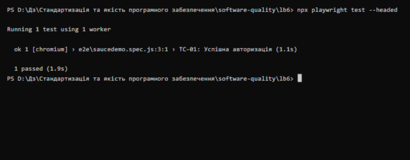
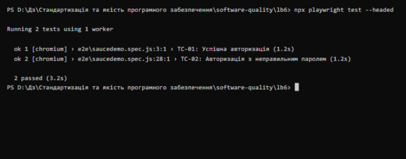
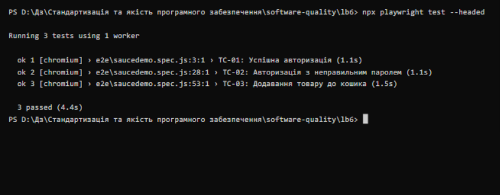
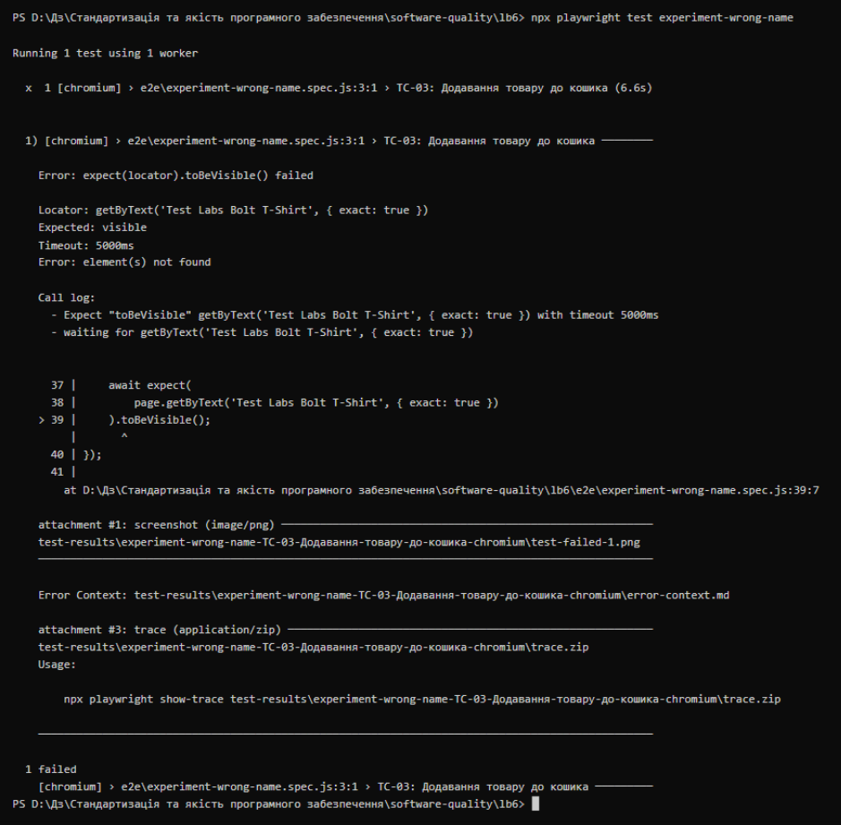
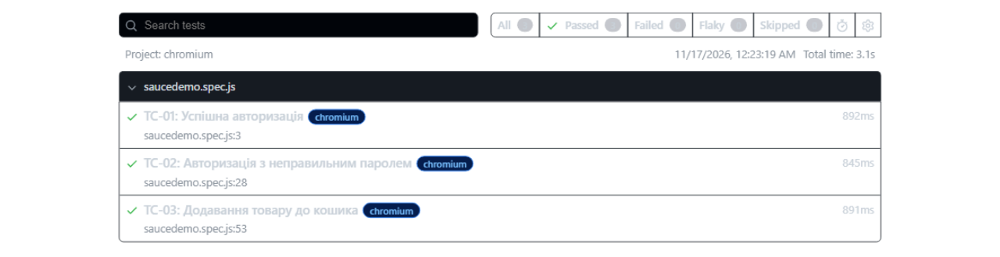
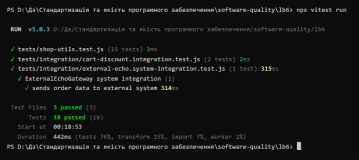

# Лабораторна робота №6

## Автоматизація тестування вебінтерфейсу з використанням Playwright

**Виконав:** Зиков Олександр

**Дата:** 17.11.2026

---

## Середовище тестування

- Мова: JavaScript
- Інструмент: Playwright (v1.65.1, @playwright/test)
- Браузер: Chromium (Desktop Chrome)
- Об'єкт тестування: <https://www.saucedemo.com/>
- ОС: Windows 10 (x64, build 19045)

## Test Cases

| ID | Тестовий сценарій | Очікуваний результат |
|---|---|---|
| TC-01 | Успішна авторизація | Відкривається каталог товарів |
| TC-02 | Авторизація з неправильним паролем | Відображається повідомлення про помилку |
| TC-03 | Додавання товару до кошика | Вибраний товар відображається в кошику |

## Реалізовані тести

| ID | Сценарій | Статус |
|---|---|---|
| TC-01 | Успішна авторизація | Passed |
| TC-02 | Авторизація з неправильним паролем | Passed |
| TC-03 | Додавання товару до кошика | Passed |

## Результати тестування

### TC-01. Успішна авторизація

**Expected Result:**

Після введення правильного логіна та пароля (standard_user / secret_sauce) і натискання Login відкривається сторінка каталогу товарів.

**Actual Result:**

Після натискання Login відкрилася сторінка inventory.html, відобразився заголовок Products.

**Status:** Passed

### TC-02. Неправильний пароль

**Expected Result:**

Після введення стандартного логіна та неправильного пароля (wrong_password) відображається повідомлення про помилку.

**Actual Result:**

Після натискання Login відобразився блок помилки (data-test="error") з текстом "Epic sadface: Username and password do not match any user in this service".

**Status:** Passed

### TC-03. Додавання товару до кошика

**Expected Result:**

Після авторизації додавання Sauce Labs Bolt T-Shirt до кошика збільшує індикатор кошика до 1, у кошику відображається назва товару.

**Actual Result:**

Товар додано до кошика (індикатор показує 1), у кошику відображається Sauce Labs Bolt T-Shirt.

**Status:** Passed

## Експеримент

Допущено помилку у назві товару у перевірці (Test Labs Bolt T-Shirt замість Sauce Labs Bolt T-Shirt) - тест отримав **FAILED**: `expect(locator).toBeVisible() failed, Element(s) not found`. У звіті Playwright видно помилку, а за допомогою Trace Viewer (trace: 'retain-on-failure') можна переглянути, на якому саме етапі сталася помилка.

## Аналіз результатів

- Усі 3 тести виконано успішно за допомогою Chromium: TC-01 (1.1s), TC-02 (1.1s), TC-03 (1.5s) у --headed режимі та 3 passed за ~3.1s у headless;
- Vitest і Playwright працюють в одному проєкті без конфліктів: Vitest виконує unit- та integration-тести (18 passed, директорія e2e виключена через configDefaults.exclude), Playwright - браузерні тести з e2e/;
- Failed тест в експерименті виник не через дефект застосунку, а через помилку в самому тесті (локатор очікував неіснуючий товар) - підтверджено переглядом сторінки кошика в Trace.

HTML-звіт Playwright (npx playwright test → playwright-report/index.html): 3 тести, усі Passed, з назвами, статусами та тривалістю виконання.

## Висновок

У ході лабораторної роботи опановано основні прийоми автоматизованого тестування вебінтерфейсу за допомогою Playwright:

- налаштовано Playwright у проєкті (playwright.config.js з baseURL, testIdAttribute: 'data-test', screenshot only-on-failure, trace retain-on-failure, проект chromium); Vitest та Playwright розведені по директоріях через exclude у vitest.config.js;
- реалізовано 3 автоматизовані тести за Test Cases: позитивний сценарій авторизації (TC-01), негативний сценарій авторизації з неправильним паролем (TC-02) та сценарій додавання товару до кошика з перевіркою індикатора й назви товару (TC-03);
- використано локатори getByTestId() та getByText(), дії fill()/click(), Web-First Assertions (toHaveURL, toBeVisible, toContainText, toHaveText) з автоматичним очікуванням;
- усі 3 тести мають статус Passed за фактичним запуском; HTML-звіт Playwright показує кількість тестів, їхні назви, статуси та тривалість виконання;
- експеримент з помилкою у назві товару продемонстрував, як виглядає невдалий тест у звіті та Trace Viewer, і що причину невдачі потрібно аналізувати (тест чи застосунок).
